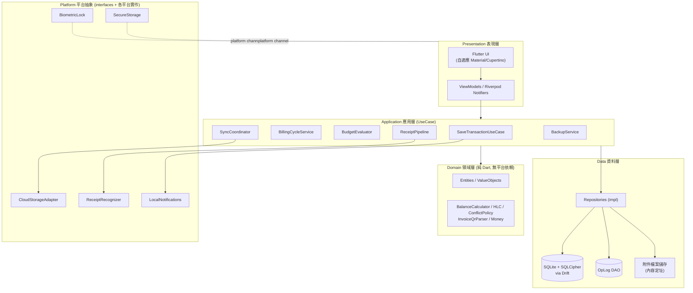
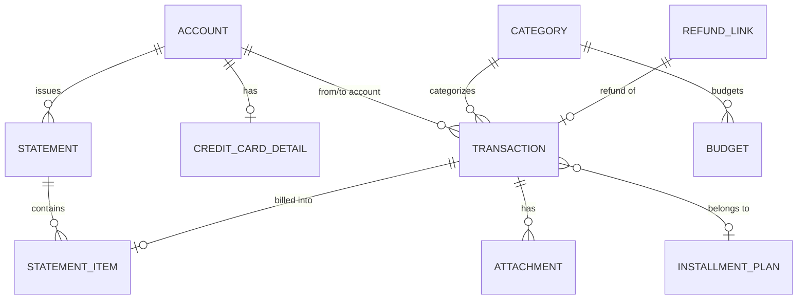
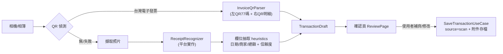
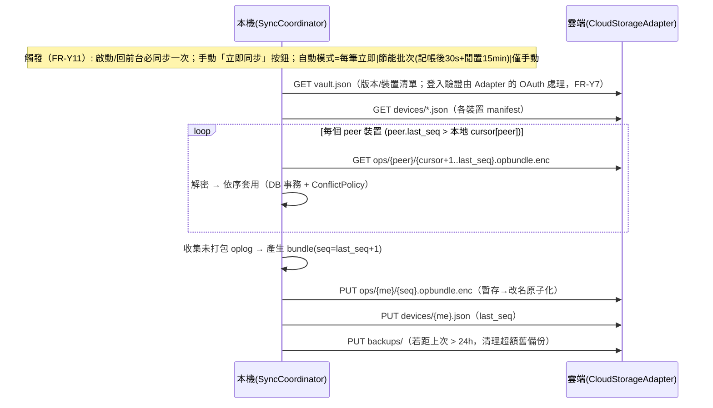

# LedgerSync 記帳 App — 軟體設計文件（SDD）

| 項目 | 內容 |
|---|---|
| 文件版本 | v0.3（草案） |
| 日期 | 2026-10-18 |
| 對應需求文件 | `SPEC.md`（功能需求 ID 以 FR-xx 對應） |
| 技術決策 | Flutter 跨平台 / 台灣發票全套（QR+OCR）/ 雲端檔案同步（帳號授權式，無自建後端、無同步密碼） |

> **v0.2 修訂**（對應 SPEC v0.2）：同步驗證改帳號授權式（FR-Y7）、快記改每筆確認（FR-Q2/Q3）、結帳歸屬每卡可設定（FR-C2）、發票掃描獨立入口（FR-S6）、預算擴充收入目標（FR-B6/B7）、定期交易提醒確認制（FR-T5）。

> **v0.3 修訂**（對應 SPEC v0.3）：同步觸發時機明確化（FR-Y11）——啟動/回前台必自動同步一次；新增手動「立即同步」按鈕；自動同步模式設定三選一（每筆立即 / 節能批次 / 僅手動）。

---

## 1. 設計原則

1. **Local-first**：唯一事實來源是本地 SQLite DB；雲端只是同步/備份媒介。斷網時 100% 功能可用（FR-Q6、NFR-04）。
2. **衍生餘額**：任何餘額、帳單應繳、預算用量都不直接儲存，一律由交易即時/快取重算。這是同步衝突安全的根基（FR-Y5）。
3. **單一程式碼庫**：領域邏輯為平台無關純 Dart；平台差異（OCR、生物辨識、雲端 SDK）全部藏在介面後面。
4. **預設安全**：本地 DB 加密、App 鎖；雲端以帳號授權 + 權杖安全儲存保護（選用加密列 P2，見 SPEC FR-Y7）；機敏值不落明文。
5. **Append + 墓標**：業務資料不物理刪除（除附件可 GC），刪除以 `deleted_at` 墓標表達，供同步合併。

---

## 2. 系統架構

### 2.1 分層架構（Clean Architecture）



- **依賴方向**：Presentation → Application → Domain；Data/Platform 實作 Domain/Data 定義的介面（依賴反轉）。
- **測試策略對應**：Domain 與 Application 層可完全脫離 Flutter 測試（NFR-10）；Platform 層以 fake 實作做整合測試。

### 2.2 專案結構（建議）

```
lib/
├── core/            # Money, HLC, Result, 時間工具, 常數
├── domain/
│   ├── entities/    # Account, Transaction, Statement, Budget...
│   └── services/    # BalanceCalculator, BillingCyclePolicy, InvoiceQrParser, ConflictPolicy
├── application/     # UseCases / Services ( orchestrators )
├── data/
│   ├── drift/       # Drift tables, DAOs, DB class
│   ├── repositories/
│   └── sync/        # OpLog, BundleBuilder, BundleApplier, SyncCoordinator
├── platform/
│   ├── cloud/drive/ # GoogleDriveAdapter
│   ├── cloud/icloud/# ICloudAdapter (iOS/macOS)
│   ├── ocr/         # MlKitRecognizer / AppleVisionRecognizer / WindowsOcrRecognizer
│   └── secure/      # keychain / keystore / DPAPI bridges
└── presentation/
    ├── screens/     # dashboard, ledger, quick_entry, budget, settings, scan...
    └── widgets/
```

---

## 3. 技術選型

| 領域 | 選擇 | 理由 / 備註 |
|---|---|---|
| 框架 | Flutter 3.x（Dart 3） | 單一程式碼庫覆蓋 iOS/Android/Windows/macOS；桌面支援成熟 |
| 狀態管理 | Riverpod 2 | 編譯期安全、易測試 |
| 路由 | go_router | 支援桌面深連結與分欄布局 |
| 資料庫 | SQLite + **Drift** + sqlcipher_flutter_libs | 型別安全 ORM、支援 Reactive Streams（餘額/清單即時更新）、四平台皆可用 |
| 金額 | `int` minor units（自訂 Money VO） | 禁用浮點 |
| QR 掃描 | mobile_scanner（iOS/Android）+ ZXing（Windows/macOS 後備） | 需支援同畫面雙 QR 連讀 |
| OCR | Android/iOS：ML Kit Text Recognition v2；macOS：Apple Vision；Windows：Windows.Media.OCR | 統一抽象 `ReceiptRecognizer`（§5.4），全本機 |
| Google Drive | googleapis（REST v3）+ google_sign_in（行動）/ OAuth loopback（桌面） | scope：`drive.appdata`（隱藏應用資料夾） |
| iCloud | CloudKit private database（CKAsset）經 platform channel / community plugin | 僅 iOS/macOS；與 Drive 共用同一檔案式協議（§6） |
| 加密 | AES-256-GCM（`cryptography` 套件；雲端內容選用加密列 P2）+ Argon2id（檔案密碼 KDF） | 同步驗證為帳號授權式（SPEC FR-Y7），金鑰設計見 §7 |
| 安全儲存 | flutter_secure_storage | Keychain / Keystore / DPAPI |
| 生物辨識 | local_auth | Face/Touch/Hello/指紋 |
| 通知 | flutter_local_notifications | 預算/繳款提醒（FR-B4、FR-C4） |
| 圖表 | fl_chart | 趨勢/占比 |
| 搜尋 | SQLite FTS5 | 備註/商家全文搜尋（FR-R3） |
| 序列化 | freezed + json_serializable | 實體與 OpBundle 模型 |
| 測試 | flutter_test + drift 測試 DB + mocktail | 見 §10 |

---

## 4. 資料模型

### 4.1 ER 圖



### 4.2 資料表（DDL 摘要，Drift 對應）

> **Schema 事實來源**：完整 schema（含 FR-T5 定期交易、樣板、設定、同步事件、FTS5 影子表）以 `specs/truth/data-spec.dbml` 為準（DBML 格式，可用 DBML 預覽工具檢視）；本節僅列核心摘要。

通用欄位（所有業務表皆有）：`created_at`(ms, UTC)、`updated_at`(ms)、`hlc`(TEXT, 變更版本戳)、`deleted_at`(nullable 墓標)。

```sql
-- 帳戶
CREATE TABLE accounts (
  id TEXT PRIMARY KEY,            -- UUIDv7
  type TEXT NOT NULL,             -- cash | bank | credit | ewallet | other
  name TEXT NOT NULL,
  currency TEXT NOT NULL DEFAULT 'TWD',
  opening_amount_minor INTEGER NOT NULL DEFAULT 0,
  color TEXT, icon TEXT, sort_order INTEGER,
  include_in_totals INTEGER NOT NULL DEFAULT 1,  -- 是否計入合併統計（FR-A2/A6；0=不列入資產/負債/淨值）
  archived INTEGER NOT NULL DEFAULT 0,
  created_at INTEGER, updated_at INTEGER, hlc TEXT, deleted_at INTEGER
);

-- 信用卡專屬設定
CREATE TABLE credit_card_details (
  account_id TEXT PRIMARY KEY REFERENCES accounts(id),
  last4 TEXT,
  statement_day INTEGER NOT NULL,        -- 1..28
  due_offset_days INTEGER NOT NULL,      -- 繳款日 = 結帳日 + N
  linked_account_id TEXT REFERENCES accounts(id),  -- 扣款帳戶(可null=手動)
  boundary_rule TEXT NOT NULL DEFAULT 'include',   -- 結帳日歸屬(SPEC FR-C2): include=當天算本期 | exclude=當天算下期
  credit_limit_minor INTEGER
);

-- 分類（一層子分類: parent_id）
CREATE TABLE categories (
  id TEXT PRIMARY KEY,
  kind TEXT NOT NULL,             -- expense | income
  parent_id TEXT REFERENCES categories(id),
  name TEXT NOT NULL, icon TEXT, color TEXT, sort_order INTEGER,
  is_system INTEGER NOT NULL DEFAULT 0,
  created_at INTEGER, updated_at INTEGER, hlc TEXT, deleted_at INTEGER
);

-- 交易（核心表）
CREATE TABLE transactions (
  id TEXT PRIMARY KEY,            -- UUIDv7（含時間序，利於排序）
  kind TEXT NOT NULL,             -- expense | income | transfer | repayment | refund
  amount_minor INTEGER NOT NULL,  -- 正數; 方向由 kind+帳戶語意決定
  currency TEXT NOT NULL,
  fx_rate REAL,                   -- 非本位幣時的換算率（記錄用）
  account_id TEXT NOT NULL REFERENCES accounts(id),
  to_account_id TEXT REFERENCES accounts(id),   -- transfer/repayment 用
  category_id TEXT REFERENCES categories(id),
  merchant TEXT, note TEXT,
  tags TEXT,                      -- JSON array
  occurred_at INTEGER NOT NULL,   -- 消費/發生時間（ms）
  source TEXT NOT NULL DEFAULT 'manual',  -- manual | scan | template | recurring | import
  split_group_id TEXT,            -- 拆分交易群組
  settlement_status TEXT NOT NULL DEFAULT 'none',
                                  -- none(非信用卡) | pending | billed | settled
  installment_plan_id TEXT, installment_seq INTEGER,
  created_at INTEGER, updated_at INTEGER, hlc TEXT, deleted_at INTEGER
);
CREATE INDEX idx_tx_time ON transactions(occurred_at);
CREATE INDEX idx_tx_account ON transactions(account_id, occurred_at);
CREATE INDEX idx_tx_category ON transactions(category_id, occurred_at);

-- 退款關聯
CREATE TABLE refund_links (
  refund_tx_id TEXT PRIMARY KEY REFERENCES transactions(id),
  original_tx_id TEXT NOT NULL REFERENCES transactions(id)
);

-- 信用卡帳單
CREATE TABLE statements (
  id TEXT PRIMARY KEY,
  account_id TEXT NOT NULL REFERENCES accounts(id),
  period_start INTEGER NOT NULL, period_end INTEGER NOT NULL,
  statement_date INTEGER NOT NULL, due_date INTEGER NOT NULL,
  total_minor INTEGER NOT NULL,          -- 應繳
  paid_minor INTEGER NOT NULL DEFAULT 0,
  status TEXT NOT NULL,                  -- issued | paid | partial
  paid_at INTEGER,
  created_at INTEGER, updated_at INTEGER, hlc TEXT, deleted_at INTEGER
);
CREATE TABLE statement_items (
  statement_id TEXT NOT NULL REFERENCES statements(id),
  transaction_id TEXT NOT NULL REFERENCES transactions(id),
  PRIMARY KEY (statement_id, transaction_id)
);

-- 分期計畫
CREATE TABLE installment_plans (
  id TEXT PRIMARY KEY,
  account_id TEXT NOT NULL,
  total_minor INTEGER NOT NULL, installments INTEGER NOT NULL,
  first_date INTEGER NOT NULL, note TEXT,
  created_at INTEGER, updated_at INTEGER, hlc TEXT, deleted_at INTEGER
);

-- 預算
CREATE TABLE budgets (
  id TEXT PRIMARY KEY,
  category_id TEXT REFERENCES categories(id),   -- null = 總預算
  amount_minor INTEGER NOT NULL,
  period_start_day INTEGER NOT NULL DEFAULT 1,  -- 1..28
  rollover INTEGER NOT NULL DEFAULT 0,
  created_at INTEGER, updated_at INTEGER, hlc TEXT, deleted_at INTEGER
);

-- 附件（中繼資；blob 本體存檔案系統 + 雲端 blobs/）
CREATE TABLE attachments (
  id TEXT PRIMARY KEY,
  transaction_id TEXT NOT NULL REFERENCES transactions(id),
  sha256 TEXT NOT NULL,           -- 內容定址，同步去重
  mime TEXT, byte_size INTEGER,
  created_at INTEGER, hlc TEXT, deleted_at INTEGER
);

-- 同步
CREATE TABLE oplog (             -- 本機未打包變更（追加了就會被打包上傳）
  seq INTEGER PRIMARY KEY AUTOINCREMENT,
  entity TEXT NOT NULL,          -- accounts|categories|transactions|statements|budgets|attachments...
  entity_id TEXT NOT NULL,
  hlc TEXT NOT NULL,
  payload TEXT,                  -- JSON 全欄位快照；NULL=刪除墓標
  packed_seq INTEGER             -- 已打包進哪個 bundle（未打包=NULL）
);

-- 附件 blob 本體以 {sha256} 命名存於 app 支援目錄 blobs/
-- FTS5 虛擬表: transactions_fts(merchant, note) 供全文搜尋
```

**設計要點**
- `settlement_status` 直接放在交易上：pending（預扣）→ billed（已結入帳單）→ settled（帳單已繳）。同步時為整列 LWW，不拆欄。
- `hlc` 為每列版本戳（§5.5.4），同步合併以此判定新舊。
- 金額一律整數 minor units（TWD 無小數 = 元），永不用浮點運算金額。

### 4.3 餘額與衍生值（BalanceCalculator）

```
資產帳戶餘額(cash/bank/ewallet/other) =
    opening_amount
  + Σ income(account_id = A)
  + Σ transfer.in(to_account_id = A)
  - Σ expense(account_id = A)
  - Σ transfer.out(account_id = A)
  （排除 deleted_at IS NOT NULL；包含該帳戶信用卡還款轉出）

信用卡：
  本期應付(open) = Σ expense(settlement_status = pending, occurred_at ∈ 當前期間)
  已出帳未繳    = Σ statements(status ∈ {issued, partial}) . (total - paid)
  未來已承諾    = Σ expense(installment 未到期，occurred_at > now)
```

- 實作以 SQL 聚合 + Drift Stream 快取，任何交易寫入自動刷新 UI（NFR-01）。
- **餘額永不寫回 accounts 表**（原則 2）。

---

## 5. 核心模組設計

### 5.1 連續快速記帳（FR-Q）

**狀態機（QuickEntryController）**

```
[Ready] --輸入金額--> [Inputting] --儲存--> [Committing] --成功--> [SavedDialog]
                          |                    |
                          +--取消--> [Ready]   +--失敗--> [Inputting](保留輸入+錯誤提示)

[SavedDialog]「繼續記下一筆？」（顯示本次連記 N 筆）
  ├─ 繼續         --> [Ready']（sticky 欄位保留、金額清空、時間重設為現在、連記計數+1）
  ├─ 復原上一筆   --> [Ready']（剛儲存之交易軟刪除 + oplog 墓標）
  └─ 完成         --> 離開快記，回到進入前畫面

[Ready'] = Ready 但保留 sticky 欄位（帳戶/分類/商家）
```

- **儲存事務**：`SaveTransactionUseCase` 在**同一個 DB transaction** 內寫入 `transactions` + 追加 `oplog`，保證不會出現「有交易但沒有同步記錄」。
- **Sticky 欄位**：帳戶、分類、商家保留至下一筆（可一鍵改）；金額與時間每筆重設（時間重設為現在，FR-Q5）。
- **Undo**：於「繼續記下一筆？」對話框內點「復原上一筆」撤銷剛儲存的交易（軟刪除墓標 + oplog 追加）；離開快記頁後不再提供（FR-Q2/Q3）。
- **模式列（PM 2026-10-24 定稿）**：**僅 支出／收入／轉帳**（`QuickEntryMode`）。
  「拆分」移至**明細→編輯交易**（FR-T6 入口另開）；「預算」設定回**預算頁表單**。
  **三種模式的類別各自獨立**：支出→expense 分類集、收入→income 分類集、轉帳→無分類。
- **欄位版面（兩平台一致）**：模式列 → 金額 → **三欄主類別格**
  日期列（◀▶）→ **帳戶 ｜ 分類（同一列兩欄）**／（轉帳：來源 ｜ 目標帳戶＋「分類／商家
  不適用」）→ 商家 → 備註 → 常駐計算機鍵盤。
  **PM 2026-10-25**：①**移除三欄主類別快捷格**（原 `MainCategoryGrid`）——分類一律由
  「分類」欄開彈窗（超商/手機同版面）②手機對齊 **03 雛型**：金額**置中**＋下方
  「帳戶：X（Sticky）」小字、「本次已記 N 筆」③**桌面面板亦有常駐鍵盤**（與手機共用
  `AmountKeypad`；原獨立「OK 儲存」大按鈕移除）。
- **計算機鍵盤（PM 2026-10-24 改版）**：第一排 **C／⌫／OK**（OK 取代「＝」）；
  數字 3×3＋÷×－；末排 **0 跨兩格／. ／＋**（＋ 移至原 ⌫ 位）。**無「＝」鍵**——
  運算式**即時求值**（尾運算子／÷0 → 未定 → OK 禁用）。
- **分類選擇彈窗（PM 2026-10-25 定稿）**：「分類」欄點選 → 彈窗——
  **左欄最上方「⭐ 常用類別」**（MRU 前 10；無紀錄時隱藏）→ 點它，**右欄列出常用類別文字**
  （**主類別＝名稱；子類別＝主類別 emoji ＋ 子類別名**，如「🍜 早餐」），點文字即選取；
  點左欄主類別 → 右欄列出該主類別之子類別（首項「（不分類）」＝只記主類別）；各欄**頂部**「＋」
  即建即選。手機與 PC **共用同一元件**（`category_picker_dialog.dart`）。原「上方常用 chips」已移除。
- **備註欄位（PM 2026-10-24）**：`note` 選填，手機與 PC 皆有；屬每筆欄位（不 Sticky）。
- **分類圖示顯示（PM 2026-10-25；`category_display.dart` 唯一來源）**：`categoryEmojiOf`
  ＝①自身 `icon` 在**圖示庫**（34 emoji）內 → 用它；②否則子類別 → 取**主類別** `icon`
  （子類別入庫為**空字串**，不可用 `??` 判斷）；③皆無（含舊代碼如 `shopping_basket`）→ **🏷️**。
  套用於類別設定／快記（手機＋桌面）／彈窗／明細列／最近刪除列——**跨頁一致**。
- **「記住上次」記憶（PM 2026-10-24）**：`QuickEntryMemory` 以**分類**為單位記住上次
  **金額／帳戶／商家**（settings `quick.last.{categoryId}`＝**本機 UX 記憶**，不進 oplog、
  不隨雲端同步）；選到該分類即帶入（日期仍為現在），方便微調後直接存。
- 桌面版：同元件置於右側面板，`Ctrl+N`/`⌘N` 聚焦（FR-Q7）。

### 5.2 信用卡帳單引擎（FR-C）

**觸發時機**：App 啟動、前台恢復、新增信用卡交易後（不依賴背景排程，見 SPEC §10.6）。

```
runBillingCycle(card):
  today = localDate(now)
  anchor = 最早結帳錨點（卡建立日或上一次已出帳單日）
  loop:
    nextSt = nextStatementDate(card, anchor)     # statement_day, 月底滾動(29/30/31→clamp)
    if nextSt > today: break
    period = (anchor, nextSt] 或 (anchor, nextSt)   # 以 occurred_at 歸期
             # 依每卡 boundary_rule（FR-C2）：include(預設)=含結帳日當天→本期；exclude=結帳日當天算下期
    txs   = transactions(account=card, settlement_status=pending, occurred_at ∈ period)
    if txs非空:
      st = createStatement(period, due = nextSt + due_offset_days, total = Σ txs)
      mark txs → billed, 寫 statement_items
      notify("卡號 ****{last4} 本期帳單 {total}，{due} 繳款")
    anchor = nextSt
```

**繳款（RepayStatementUseCase）**
- 全額/部分：建立 `transfer` 交易（from = linked_account，to = card，kind = repayment），`paid_minor` 累加，全額時 `status = paid`。
- 同一 DB transaction 寫入交易 + 帳單更新 + oplog。
- 無 linked account：僅更新帳單狀態（使用者自行於外部付款）。

**分期（InstallmentPlan）**
- 建立 plan + 一次產生 N 筆未來 `pending` 交易（`installment_seq` 標記、`occurred_at` 逐期遞增）；帳單引擎照常收編到期的那筆；刪除 plan 需連動刪除未到期分期。

**退款（FR-C7）**
- refund 交易記 `refund_links.original_tx_id`。若原交易仍 pending → 兩者同時標記刪除語意（淨額為 0，保留軌跡）；若已 billed → refund 以負項計入**當期**帳單。

**邊界案例**：結帳日 29–31 遇小月 → clamp 至該月最後一日；跨年正常遞延；修改 statement_day 僅自**下一期**生效（儲存 effective_from）。

### 5.3 預算引擎（FR-B）

```
usage(budget, period) = Σ expense(分類∈scope, occurred_at ∈ period)   # 含信用卡 pending
daily_allowance = (amount - usage) / 剩餘天數
projection      = usage / 已過天數 × 總天數
```

- `BudgetEvaluator` 在交易寫入後重算受影響預算，跨過 80%/100% 閾值時投遞本機通知（每期每級別只通知一次，狀態存 settings）。
- 收入目標（FR-B6/B7）：達標率 = 本月已入帳收入 ÷ 目標額；總覽「本月預計結餘」= 收入目標 − 總支出預算，實際結餘 = 實際收入 − 實際支出（含預扣）。
- 超支與警示同時反映在總覽橫幅（Stream 驅動）。

### 5.4 發票掃描管線（FR-S）



**入口（FR-S6）**：總覽頁與明細頁各設一個獨立「掃描」按鈕（與快記流程分離）；桌面版置於工具列，快捷鍵 `Ctrl+Shift+S` / `⌘⇧S`；無相機裝置時導向相簿/檔案匯入。

**QR 解析（InvoiceQrParser，領域層純 Dart）**
- 左 QR（77 碼）：`[0,10)` 發票字軌號碼、`[10,17)` 開立日期（民國 `YYYMMDD`）、`[17,21)` 隨機碼、`[21,29)` 賣方統編、`[29,39)` 銷售額、`[39,40)` 課稅別、`[40,50)` 稅額、`[50,60)` 總金額。
- 右 QR：版本碼 + deflate 壓縮 + Base32（字元集 `0-9A-Z`）解出賣方名稱與商品明細（`品名**數量**單價**金額` 分段）。
- 驗證：長度檢查、`銷售額 + 稅額 ≈ 總計`（應稅時）、日期合理性；不合規 → 回退為手動輸入並提示（FR-S2）。
- 雙 QR 於同畫面連續偵測，齊備後合併（掃描器層維護 500ms 內的結果暫存）。

**OCR 欄位抽取**
- 日期：民國/西元多格式 regex，取「最接近今天」候選。
- 總額：關鍵字（總計/合計/TOTAL/應收/實收）鄰近數值 + 全場最大數值候選加權。
- 商家：頂部最大字級行 / 8 碼統編反查（§10 未決 3）。
- 每欄位輸出 `(value, confidence)`；`confidence < 0.7` 的欄位 UI 高亮要求人工確認；**總額一律人工確認**（FR-S5）。

**附件儲存**：原圖縮至最長邊 1600px、JPEG q70，計算 `sha256` → 存 `blobs/{sha256}`，寫入 `attachments`。同步時上傳至雲端 `blobs/{sha256}.bin.enc`（內容定址天然去重）。

### 5.5 同步引擎（FR-Y4/Y5）— 檔案式 OpLog 合併

#### 5.5.1 雲端檔案佈局（Google Drive appDataFolder / CloudKit private DB 兩者結構相同）

```
LedgerSync/
├── vault.json                      # 唯一未加密檔：schema_ver、裝置清單（無同步密碼；僅 P2 選用加密時含 KDF 參數與包裹金鑰）
├── devices/{device_id}.json        # 每裝置一份 manifest（避免多裝置寫同一檔案衝突）
│     { app_ver, schema_ver, last_seq, ack_seq }   # ack_seq = 該裝置已確認讀到哪
├── ops/{device_id}/{seq:08d}.opbundle.enc   # 變更批次（加密）
├── blobs/{sha256}.bin.enc          # 附件（內容定址）
└── backups/{yyyyMMdd_HHmmss}.db.enc # 全量快照（壓縮+加密）
```

> **加密後綴說明**：檔名中 `.enc` / `.bin.enc` 僅於啟用選用加密（P2，FR-Y7）時存在；預設為明文檔案，由雲端帳號權限保護（SPEC §10-8）。

#### 5.5.2 OpBundle 格式

```json
{
  "device_id": "d-A1B2",
  "seq": 42,
  "schema_ver": 3,
  "ops": [
    { "e": "transactions", "id": "018f…", "hlc": "0001700000000123.000005.d-A1B2",
      "row": { "…整列欄位快照…" } },
    { "e": "categories", "id": "018f…", "hlc": "…", "row": null }
  ]
}
```

- `row: null` = 刪除墓標。整列快照（非欄位 diff）→ 套用冪等、簡單可靠。
- seq 於單一裝置內嚴格遞增；接收端按 `(device, seq)` 排序套用。

#### 5.5.3 Push / Pull 流程



- **冪等**：同 seq 檔名重複上傳直接覆蓋同名內容（hash 校驗）；套用端以「(device,seq) 已套用 cursor」跳過重複。
- **寫入衝突**：每裝置只寫 `devices/{自己}.json` 與自己的 `ops/`，跨裝置零衝突；僅 `vault.json` 於首次建置時寫入一次。
- **GC**：所有 peer 的 `ack_seq` 都 ≥ 某 bundle seq 時可刪除該 bundle（保守起見保留最近 20 個）。

#### 5.5.4 版本戳與衝突策略（ConflictPolicy）

- **HLC**：`{毫秒時間:015d}.{計數器:05d}.{device_id}`。本機寫入時 `max(本地時鐘, 看過的最大 HLC 時鐘) + 計數器`，接收時同步推進——保證全網嚴格可比。
- **合併規則**：套用 op 時，若目標列不存在 → insert；存在且 `incoming.hlc > local.hlc` → 整列覆蓋（LWW）；否則忽略。
- **衝突通知**：當「本機曾寫入某列（oplog 有該 id 未被打包的記錄）卻被更高 HLC 覆蓋」時，記一筆衝突事件至 `sync_events`，同步狀態頁可檢視（FR-Y5，提供被覆蓋內容的唯讀快照）。
- **為何安全**：所有金額性衍生值（餘額、帳單、預算用量）由交易重算；LWW 覆蓋只影響單列欄位，不會造成帳務不守恆。

#### 5.5.5 新裝置 Bootstrap

1. 登入**同一**雲端帳號（OAuth 授權，無需任何同步密碼，FR-Y7/AC-08）→ 讀 `vault.json` 取得裝置清單與 schema 版本。
2. 下載最新 `backups/*.db.enc` 匯入（無備份則空 DB；P2 選用加密或備份檔含檔案密碼時先解密）。
3. 依 `(device, seq)` 順序 replay 所有裝置自備份時間點後的 bundles。
4. 完成後寫入自己的 `devices/{me}.json`。

#### 5.5.6 附件同步

- 上傳：`attachments.sha256` → 檢查雲端 `blobs/{sha256}.bin.enc` 是否存在 → 不存在才上傳（內容定址去重）。
- 下載：套用到含附件的 op 時懶下載 blob（列表先顯示佔位）。

---

### 5.6 設定群：帳戶／分類 CRUD（FR-A7／FR-B1；M8）

**契約與既有寫入路徑一致**（SDD §5.1）：每次變更＝`業務表 + oplog` 同 transaction，
`entity` 用 `accounts`／`categories`，`payload` 為整列快照（含 `hlc`）——
故多裝置以既有 LWW（§5.5.4）合併，**不需新增同步邏輯**。

| 服務 | 職責 | 邊界 |
|---|---|---|
| `AccountService` | create/update（名稱、類型、期初餘額、`include_in_totals`、封存）／archive／delete | 刪除：有未結算交易 → 拒絕並提示轉移（FR-A2）；有交易引用 → 僅允許封存 |
| `CategoryService` | create/update（名稱、圖示、顏色、父分類）／reorder（`sort_order` 連續化）／archive／delete | 一層子分類（FR-B1）；有交易引用 → 拒絕刪除並提示；系統內建分類僅可封存 |
| `BalanceCalculator`（改動） | 資產/負債/淨值（FR-A6）**僅計入 `include_in_totals＝true`** 且未封存之帳戶 | 個別帳戶餘額顯示不受影響（僅合計排除） |

**FE 設定頁**：`AccountSettingsPage`／`CategorySettingsPage`／`AppearanceSettingsPage`
（主題 `app.theme_mode`：system|light|dark → `MaterialApp.themeMode` 即時套用）。
測試鍵前綴：`acct-*`／`cat-*`／`theme-*`（dsl §3 登記）。

**跨頁連動（DBG-009；PM 2026-10-23）**：分類/帳戶 CRUD 完成後，除本頁 `setState` 外**必須使衍生快取失效**
（FE `ref.invalidate(expenseCategoriesProvider／incomeCategoriesProvider／ledgerProvider)`）——
否則快記分類格／預算頁／明細列停留舊名稱、舊圖示（Riverpod `Provider` 快取語意）。
子分類列同享編輯入口（`cat-edit-{name}`：改名／顏色）。

**子類別無圖示（PM 2026-10-24）**：子類別不擁有 `icon`——顯示一律取**主類別**圖示
（`icon = 子.icon ?? 主.icon`）；編輯表單對子類別**不提供**圖示選項（儲存清為空）；
彈窗右欄與分類管理子列僅顯示名稱（圖示已由主類別承載）。

---

## 6. 雲端儲存抽象層

```dart
abstract interface class CloudStorageAdapter {
  Future<bool> isConfigured();                       // 已登入且可用
  Future<List<RemoteEntry>> list(String folder);
  Future<void> upload(String path, List<int> bytes); // 暫存→原子改名
  Future<List<int>?> download(String path);          // 不存在回 null
  Future<void> delete(String path);
  Future<void> ensureFolder(String folder);
}
```

| 實作 | 平台 | 技術 | 備註 |
|---|---|---|---|
| `GoogleDriveAdapter` | 全平台 | Drive REST v3, `appDataFolder`；行動用 google_sign_in，桌面用 loopback OAuth | 免費 15GB 由使用者承擔；上傳用 resumable |
| `ICloudAdapter` | iOS/macOS | CloudKit private DB：每個遠端「檔案」= 一筆 record + CKAsset | 與 Drive 相同檔案語意；Android/Windows 回傳 `isConfigured()=false` 並由 UI 顯示不支援說明（SPEC §4） |

同步協議（§5.5）完全不感知後端差異——只要能 list/upload/download/delete 即可，這也是未來接 WebDAV/S3 的擴充點。

---

## 7. 安全設計（FR-X、FR-Y7、NFR-06）

### 7.1 驗證與金鑰設計（v0.2 依 SPEC FR-Y7：帳號授權式同步，無同步密碼）

```
雲端存取驗證：
  使用者雲端帳號（Google 帳號 / Apple ID）
   └── OAuth 授權 → access/refresh token（存 OS SecureStorage，不落明文）
       └── CloudStorageAdapter 以此讀寫 LedgerSync/ 資料夾
  保護層 = 雲端帳號安全性（憑證 + 兩步驟驗證）＋ 雲端業者存取控制（SPEC §10-8）

本地保護：
  本地 DB 金鑰 (隨機 256bit，存 OS SecureStorage) ── SQLCipher 開庫用
  App 鎖：PIN + 生物辨識（FR-X1）；PIN 遺忘 → 重新登入雲端帳號驗證後重設（FR-X5）

選用加密（P2，FR-Y7）／備份檔檔案密碼（FR-Y6）：
  檔案密碼 (使用者輸入，不儲存) ──Argon2id(salt, m=64MB, t=3, p=1)──> KEK ──包裹──> DEK
   └── DEK 加密雲端內容 / 備份檔；換密碼 = 重新包裹 DEK（歷史密文不動、免重傳）
```

- 雲端加密檔格式（僅 P2 啟用時）：`magic(4) | version(1) | nonce(12) | ciphertext | GCM tag`，AAD = 雲端相對路徑。
- 備份檔匯出（FR-Y6）：預設不加密；選檔案密碼時以上述 KEK/DEK 流程加密，匯入需對應密碼（AC-14）。

### 7.2 App 鎖與隱私

- `AppLockController`：監聽生命週期，背景逾時（預設 30s）→ 鎖定；`local_auth` 生物辨識，失敗三次退回 PIN。
- Windows：DPAPI 保護 DB 金鑰 + Windows Hello。
- 隱私遮蔽：總覽頁遮蔽開關；iOS 進入 app switcher 時畫面模糊（FR-X3）。
- **`hasPin`／建構子可選 `pin`**（DBG-008）：裝置**從未設定 PIN** 時不寫 `lock.pin_hash`；
  需 PIN 之關卡（清空資料）依 `hasPin` 決定是否要求——無 PIN → **跳過**（避免 `null` 比對恆 false 將使用者鎖死）。

### 7.3 資料清除

- 「清空資料」：本地 DB 刪除 + 雲端 `LedgerSync/` 整資料夾刪除（需二次確認 + 輸入 PIN；
  已連結雲端者加驗「重新登入雲端帳號」，FR-O3）。**未設定 PIN 之裝置跳過 PIN 步驟**（`hasPin`＝false；DBG-008）。
- **範圍刪除（PM 2026-10-24）**：流程＝範圍勾選 → 警告 → PIN → 確認文字。
  `WipeService.wipeScoped(scopes, deviceId:)` 以**刪除＋oplog**表達
  （transactions＝軟刪除墓標／categories＝**預設以外**〔非 `is_system` 且非
  `FirstRunBootstrap.builtInCategoryIds`〕／accounts／budgets＝軟刪除）——多裝置合併一致；
  局部刪除**不需**雲端加驗（墓標隨同步傳播）。「回到系統預設值」＝全清空
  （`wipe`，含雲端資料夾）＋下次啟動重新播種內建集。
- **永久刪除墓標（PM 2026-10-24）**：`PurgeTombstoneUseCase`（「最近刪除」頁）——
  與 FR-T3 保留期屆滿之 `TombstonePurgeService` **同一條實體清除路徑**
  （`transactions` 列實體刪除、**oplog 墓標保留**＝同步安全）；使用者**明示**刪除，
  故**不受 30 天限制**（清空全部以「現在」為 cutoff）。

---

## 8. UI 資訊架構

**行動版**（底部 5 槽，中央為快記大鈕）：

```
[ 總覽 ] [ 明細 ] ( +快記 ) [ 預算 ] [ 設定 ]
  總覽：本月收支/淨值卡、預算進度、收入目標達標率、最近交易（含「掃描」按鈕）
  明細：帳戶橫滑列 + 交易時間軸（依日分組、日小計；含「掃描」按鈕與「待確認」badge）
  快記：全螢幕數字鍵盤 + 分類快捷格（連續記帳）
  預算：預算卡列表 + 分類明細鑽取
  設定：帳戶管理（FR-A7）、分類管理（FR-B1）、外觀（FR-O1 主題/語系）、
        雲端與同步（FR-Y7）、資料管理（FR-O3）、安全（FR-X）、關於
```

**桌面版**（Win/Mac）：

```
┌─────────┬───────────────────────────┬────────────┐
│ 側邊導航 │        主內容區            │ 快速記帳面板 │
│ 總覽/明細 │  (隨導航切換，可寬表格)      │ (Ctrl+N 呼叫│
│ 預算/帳戶 │                           │  可收合)    │
│ 報表/設定 │                           │            │
└─────────┴───────────────────────────┴────────────┘
```

關鍵流程頁面：`掃描頁（相機+掃描框+連拍）` → `確認頁（欄位高亮低信賴項、原圖縮圖）`；`同步狀態頁（裝置列表、進度、衝突檢視）`。

**設定群（FR-A7／FR-B1／FR-O1；M8）**：

```
設定 → 帳戶管理    列表（名稱/類型/餘額/是否計入合併）→ 編輯頁
                    （名稱、類型、期初餘額、計入合併統計、封存、刪除）
     → 分類管理    支出/收入 分頁 → 列表（可拖曳排序、子分類展開）
                    → 編輯（名稱、圖示、顏色、封存、刪除——有交易引用時提示）
     → 外觀        主題：跟隨系統／淺色／深色（立即生效；settings app.theme_mode）
```

> 原型對照：分類管理＝`specs/plan/ui/09-category-settings.html`（＋畫廊
> `category_settings_demo_page.dart`）；帳戶管理原型待補（`11-account-settings.html`，
> 樣式沿用 09 卡片語彙）；外觀＝`07-settings-sync.html` 之外觀段。

---

### 8.1 交易列（明細；PM 2026-10-24）
**兩平台同元件（`TxTile`）＋ `tableLayout` 切換**（寬度 ≥900px＝桌面）：
- **手機（02 雛型）**：**分日群組**（今天／昨天／MM/DD（週））＋**每日小計**（淨額＝
  income−expense；transfer/repayment 不計——AC-10）＋每日 Card；
  列＝分類圖示圓（38px；**子類別取主類別圖示**；轉帳 🏦／儲值 📲／拆分 🔀／無分類 🧾）
  ＋**標題＝分類（含子類別名）**（PM 2026-10-26：原為「商家」，多數交易無商家 → 常態顯示
  「—」；改以幾乎必有之分類為標題）＋副標 `時分 · 帳戶[ · 商家][ · 備註][ · 標籤]`。
- **桌面（08 雛型）**：**表格**——日期｜類型（+標籤）｜分類（emoji＋名）｜商家／對象｜
  帳戶｜金額（右對齊）。
- **金額**：千分位；**支出 `danger`（紅）／收入 `success`（teal）／轉帳・還款中性**
  （還款顯示負號）。
- **語意標籤**：掃描入帳（FR-S4）／預扣（FR-C6）／定期（FR-T5）／已繳（還款）。
- 待確認：AppBar 徽章改為**琥珀 pill**（`recurring-badge`；FR-T5 呈現面）。
- 帳戶 chips：作用中 teal 實心、其餘白底（02 雛型）。
- 桌面快記面板：分類欄與手機一致（顯示所選分類含子類別名）。
- **月份制（PM 2026-10-24）**：明細**預設顯示本月**；**月份列**（◀ 期間 ▾ ▶）可切換
  月份（有交易之月份清單）／**自訂區間**（DateRangePicker）／全部月份。
- **交易編輯視窗（PM 2026-10-24）**：點交易列 → `tx_edit_sheet.dart`（bottom sheet）——
  金額／日期（◀▶＋日曆）／帳戶／分類（彈窗）／商家／備註；動作 **刪除**（二次確認；
  `DeleteTransactionUseCase` 軟刪除）／取消／**儲存**（`UpdateTransactionUseCase`：
  `updateTransactionWithOplog` 整列快照，同一 DB transaction）；**拆分**（支出、
  無 split_group）＝2 子項（分類＋金額）→ `executeSplit` ＋原交易軟刪除。
  快記不再提供刪除/拆分入口。
- **統計頁 v3（PM 2026-10-26 整頁重做；雛型 `11-stats.html`）**：
  ①**月份列**＝`◀`／`2026/10`＋小字「期間（月份）」／`▶`——三者皆**白底圓角外框**
  ②**三卡**（支出紅／收入綠／淨額）＝**底色 `AppTokens.track` ＋外框**
  ③**分類占比（本月）＝依「主類別」彙總**（`ReportService.aggregateByMain`：子類別金額
  併入其所屬主類別；未分類＝未分類）＋甜甜圈 `CategoryDonut`——**百分比以引線標於圈外**
  （不壓扇區；同側標籤自動推開）＋色點圖例（`{名稱} {pct}%`＋金額；色點與扇區**同索引同色**）
  ④**月趨勢（支出）**＝白卡（長條＋`{m}月 {總計}` 列）
  ⑤色板＝**固定色** `statsPalette`（`#0B7A75/#F5C86B/#6D4FC4/#D64545/…`），
  不用 ColorScheme 衍生淡色。既有數值文字契約不變（`合計`／`{名稱} {pct}%`／`{m}月 {總計}`）。
- **最近刪除（PM 2026-10-24 增補）**：明細 AppBar 入口 → `recent_deletions_page.dart`；
  雛型 `specs/plan/ui/12-recent-deletions.html`。30 天內（**曆日**）可**還原**
  （`RestoreTransactionUseCase`）；並可**永久刪除**——單筆 `recent-delete-purge-{id}`／
  **清空全部** `recent-delete-purge-all`，兩者皆**二次確認**（`recent-delete-purge-confirm`／`-cancel`）
  → `PurgeTombstoneUseCase`：`transactions` 列**實體刪除**、**oplog 墓標保留**
  （與 `TombstonePurgeService` 30 天屆滿**同一條路徑**；未刪除者拋 StateError、
  已清除者回 0 冪等；清空全部不受 30 天限制）。

---

## 9. 錯誤處理與觀測

| 情境 | 處理 |
|---|---|
| 雲端登入失效 | 同步暫停 + 設定頁紅點提示，本地功能不受影響 |
| 網路失敗 | 指數退避重試（1/5/15min），oplog 保留待下次打包 |
| 備份檔/加密檔密碼錯誤（FR-Y6、P2 選用加密） | 直接中止匯入/還原，不動本地資料（AC-14） |
| DB 損毀 | WAL 模式 + 還原/升級前自動保護備份；提供「從雲端修復」入口 |
| Schema 升級 | Drift migration + `schema_ver` 於 vault/manifest 記錄；舊版本裝置收到新版 bundle → 提示升級，不套用 |
| 觀測 | 本地結構化 log（可匯出除敏診斷檔）；崩潰報告 opt-in |

---

## 10. 測試策略

| 層級 | 範圍 | 重點案例 |
|---|---|---|
| 單元 | 領域層（≥80%）：BalanceCalculator、BillingCyclePolicy、InvoiceQrParser、HLC、ConflictPolicy | 結帳日 clamp 月底、跨年、退款 pending/billed 兩態、QR 總額=銷售額+稅額驗證、HLC 因果排序 |
| 單元 | 應用層：SaveTransaction（交易+oplog 同事務）、RepayStatement、BudgetEvaluator 閾值 | Undo、分期產生 N 筆、通知僅觸發一次 |
| 整合 | 同步：in-memory CloudStorageAdapter 模擬雙/三裝置交錯寫入 | AC-06/07；斷網恢復補傳；bootstrap replay；GC 不丟資料 |
| 整合 | Drift DAO + FTS 搜尋 | 10 萬筆種子資料效能基準（NFR-01） |
| 金測 | 發票解析 | 蒐集 ≥100 張真實發票樣本（QR 標準/含明細/無明細），解析正確率 ≥ 98%（總額欄位 100%） |
| UI | golden tests + 手動走查腳本 | 快記流程、桌面 responsive 斷點 |
| 安全 | 權杖儲存、檔案密碼、還原流程 | 錯誤檔案密碼不動本地（AC-14）；權杖不落明文（§7.1） |

---

## 11. 風險與對策

| # | 風險 | 影響 | 對策 |
|---|---|---|---|
| R1 | iCloud 無 Android/Windows API | 同步覆蓋不完整 | 已列為產品限制（SPEC §4/§10）；遷移靠備份檔；UI 明確引導跨平台用 Google Drive |
| R2 | Google OAuth 驗證（drive.appdata 屬 sensitive scope） | 上架延誤 | M5 前提早送審；備選：`drive.file` + 使用者自選資料夾 |
| R3 | OCR 準確率不足造成錯帳 | 信任度 | 確認頁強制人工把關 + 總額必驗（FR-S4/S5）；金測準確率門檻 |
| R4 | iOS/Android 背景排程不可靠 | 帳單逾期提醒不準 | 結算採 App 開啟補算（§5.2）；通知在下一次可執行時機補發 |
| R5 | 多裝置 LWW 靜默覆蓋 | 使用者困惑 | 衝突事件 + 可檢視被覆蓋內容（§5.5.4）；文案教育「後寫入者勝」 |
| R6 | 台灣發票規格變更 | 掃描失效 | Parser 版本化 + 遠端樣本測試集；格式不符自動回退手動輸入 |
| R7 | 免費雲端空間不足 | 同步失敗 | 附件壓縮、備份份數上限、占用統計顯示 |
| R8 | 帳號授權式同步：雲端檔案預設未加密，帳號被盜即外洩 | 隱私 | 連結時強提醒開啟兩步驟驗證（SPEC §10-8）；權杖僅存 OS 安全儲存；P2 選用密碼加密（FR-Y7） |

---

## 12. 未來擴充（與 SPEC §12 未決事項對應）

1. **即時同步/家庭共享**：引入可選後端（Firebase / Supabase）做推送通知與多寫入者合併；OpLog 架構可直接平移為 CRDT/伺服器合併基礎。
2. **WebDAV/S3 後端**：CloudStorageAdapter 介面已預留。
3. **AI 自動分類**：本機 on-device 模型（依商家→分類歷史），仍維持無雲端原則。
4. **Web 版**：Flutter Web + WASM SQLite（同步協議相容，僅需瀏覽器版 Drive OAuth）。
5. **多帳本 / 匯入銀行 CSV / 報表自訂**。
